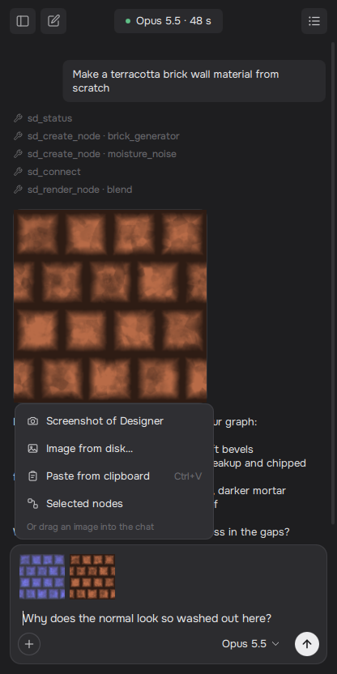

<p align="center">
  
</p>

<h1 align="center">GraphPilot</h1>

**An AI chat panel inside Adobe Substance 3D Designer.** Ask about the open graph, have it build or tweak a material, show it a screenshot — it works on your graph directly: creates and connects nodes, sets parameters, renders outputs to check its own work.

Works with **[Claude Code](https://claude.com/claude-code)** or **[OpenAI Codex](https://github.com/openai/codex)**, so it runs on the subscription you already have: Claude (Pro / Max) or ChatGPT (Plus / Pro / Business), or an API key. No extra accounts, no extra servers.

<p align="center">
  
</p>

<table>
  <tr>
    <td align="center"><br><sub>Attach screenshots or selected nodes</sub></td>
    <td align="center"><br><sub>Chat history with search</sub></td>
    <td align="center"><br><sub>Always the newest models</sub></td>
  </tr>
  <tr>
    <td align="center"><br><sub>Claude or ChatGPT, fonts</sub></td>
    <td align="center"><br><sub>10 interface languages</sub></td>
    <td></td>
  </tr>
</table>

## Features

- **Edits the graph for you**: create, connect, delete and move nodes, set parameters, use any node of the Designer library, create/open/save packages, or run arbitrary Designer Python for anything else.
- **Sees the result**: renders node outputs and looks at them before answering.
- **Screenshots**: paste with Ctrl+V, drag & drop, one-click "Screenshot of Designer", pick from disk, or attach the selected nodes.
- **Chat history**: search, rename, delete; every chat resumes with full context.
- **Claude or ChatGPT**: switch the assistant in Settings. Each chat remembers which one it was started with.
- **Model picker**: Claude's Fable, Opus, Sonnet, Haiku (always the newest version of each), or the models your ChatGPT plan offers in Codex.
- **10 languages**: English, Русский, Українська, Deutsch, Español, Français, Português, 中文, 日本語, 한국어 (follows your OS, switchable in Settings).
- **Fonts**: Onest, Inter, or your system font.

## Requirements

- **Windows** and Adobe Substance 3D Designer **16.0** or newer (tested on 16.0.3).
  macOS support is in the code but has not been tested yet: if you try it, please report in [Issues](../../issues).
- One of:
  - **Claude Code** with a Claude subscription (Pro / Max) or an Anthropic API key.
  - **Codex CLI** with a ChatGPT plan. Codex installs through npm, so it also needs [Node.js](https://nodejs.org/).

You don't need a terminal: if the assistant isn't installed or you aren't signed in, the panel shows **Install** / **Sign in** buttons. They run the official installer and the official sign-in, which opens your browser. (Or do it yourself: install from [claude.com/claude-code](https://claude.com/claude-code) and run `claude auth login`; for Codex `npm i -g @openai/codex` and `codex login`.)

Nothing else: the MCP server that connects the assistant to Designer ships with the plugin and runs on the Python that comes with Designer.

## Install

1. Download `GraphPilot-<version>.zip` from [Releases](../../releases) or [Gumroad](https://sweethava.gumroad.com/l/graphpilot) (free, pay what you want).
2. Unzip it and copy the **`graphpilot`** folder into Designer's user plugins folder:
   - Windows: `Documents\Adobe\Adobe Substance 3D Designer\python\sduserplugins\`
   - macOS (untested): `~/Documents/Adobe/Adobe Substance 3D Designer/python/sduserplugins/`
3. Restart Designer. The **GraphPilot** panel appears. If it doesn't, check that GraphPilot is enabled in *Tools ▸ Plugin Manager*.

To update, replace the `graphpilot` folder and restart Designer. Your chats and settings are kept.

## Usage tips

- Open a graph first, then ask: *"Make a mossy stone wall"*, *"Why is my normal map so flat?"*, *"Add a dirt pass driven by the AO output"*.
- **Enter** sends, **Shift+Enter** for a new line, **Ctrl+V** pastes a screenshot.
- The button in the top-right corner shows or hides the tool steps Claude takes.
- Save your package before big requests, so you can always go back.

## Privacy & security

- Your messages, graph information and attached images are sent to Anthropic (through Claude Code) or OpenAI (through Codex), under your account's terms with that provider. GraphPilot itself has no servers and collects nothing.
- Chats and the bridge token are stored locally: `%APPDATA%\GraphPilot` (Windows), `~/Library/Application Support/GraphPilot` (macOS).
- The plugin opens a bridge on **127.0.0.1:9881** (local machine only) that runs Python inside Designer — that is how the assistant edits the graph. Each request must carry a random token that is regenerated on every Designer start and stored in `bridge.json` in the folder above, which only your user account can read. Programs running under your account can still read it, so only run software you trust.
- In the panel Claude may use the Designer tools, read files (`Read`, `Glob`, `Grep`) and search the web. Codex runs in its read-only sandbox plus the Designer tools. One of the Designer tools runs Python inside Designer, so in practice Claude has the same access to your computer as Designer itself. Review what it does in the tool steps.

## Troubleshooting

| Problem | Fix |
|---|---|
| The Install button fails | Install by hand: Claude Code from [claude.com/claude-code](https://claude.com/claude-code); Codex with `npm i -g @openai/codex` (needs Node.js). Then reopen Settings. |
| Sign-in doesn't finish | Press **Open sign-in page** and finish in the browser, or run `claude auth login` / `codex login` in a terminal. |
| "Cannot reach the Substance Designer bridge" | Another program uses port 9881, or a second Designer instance is running. Close it and restart Designer. |
| Fable says it "requires usage credits" | Your plan doesn't include Fable; pick another model. |

## Building from source

```
tools/build.py      → dist/GraphPilot-<version>.zip
```

Run it with any Python 3.9+ (Designer's own works: `"C:\Program Files\Adobe\Adobe Substance 3D Designer\plugins\pythonsdk\python.exe" tools\build.py`).

Project layout:

```
graphpilot/                 ← the plugin folder that goes into sduserplugins
  pluginInfo.json
  graphpilot/
    __init__.py             plugin entry + TCP bridge (runs code on Designer's main thread)
    helpers.py              graph operations used by the tools
    mcp_server.py           MCP stdio server (stdlib only) launched by the assistant CLI
    agents.py               Claude Code / Codex adapters (launch args, event parsing)
    chat_qml.py, chat.qml   the chat panel (backend + UI)
    chat_panel.py           Claude Code launch settings + basic fallback panel
    i18n.py                 UI strings
```

How the pieces fit together and where to add features: [docs/ARCHITECTURE.md](docs/ARCHITECTURE.md).

## Credits

The panel's look was inspired by the [Lumen AI chatbot concept](https://www.pinterest.com/pin/1096696946794658982/) by Good Things Come in Components.

## Support

Bugs and ideas: [Issues](../../issues). If GraphPilot saves you time, you can support it on [Gumroad](https://sweethava.gumroad.com/l/graphpilot) — pay what you want.

## License

[MIT](LICENSE) © SweetHava. Bundled fonts: see [THIRD_PARTY_NOTICES.md](THIRD_PARTY_NOTICES.md).

GraphPilot is an independent project, not affiliated with or endorsed by Adobe, Anthropic or OpenAI. Adobe and Substance 3D are trademarks of Adobe Inc.; Claude is a trademark of Anthropic, PBC; ChatGPT and Codex are trademarks of OpenAI.
