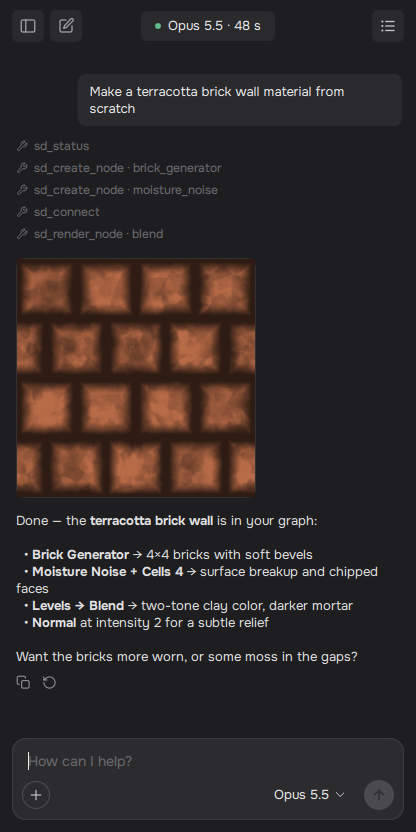
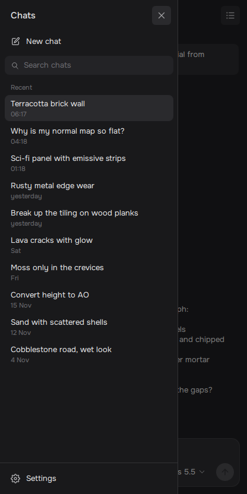
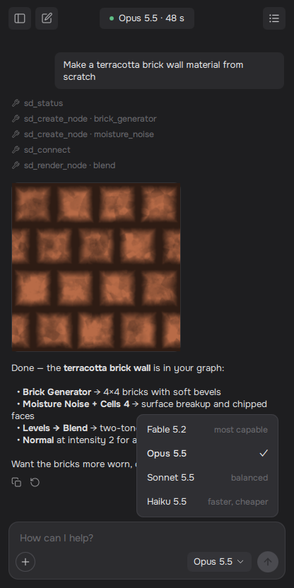
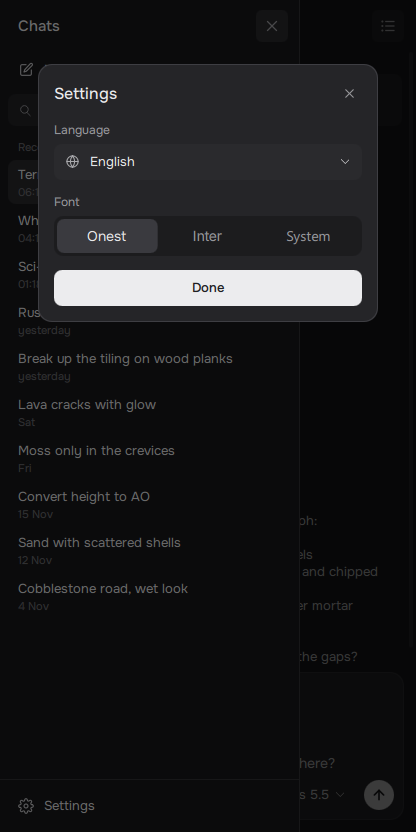
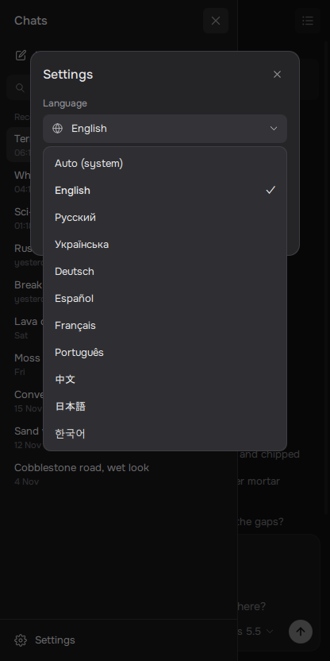

# GraphPilot

**An AI chat panel inside Adobe Substance 3D Designer.** Ask about the open graph, have it build or tweak a material, show it a screenshot — it works on your graph directly: creates and connects nodes, sets parameters, renders outputs to check its own work.

Works with **[Claude Code](https://claude.com/claude-code)**, so it runs on your existing Claude subscription (Pro / Max) or an Anthropic API key. No extra accounts, no extra servers.

<p align="center">
  
</p>

<table>
  <tr>
    <td align="center"><br><sub>Attach screenshots or selected nodes</sub></td>
    <td align="center"><br><sub>Chat history with search</sub></td>
    <td align="center"><br><sub>Always the newest models</sub></td>
  </tr>
  <tr>
    <td align="center"><br><sub>Fonts: Onest, Inter, system</sub></td>
    <td align="center"><br><sub>10 interface languages</sub></td>
    <td></td>
  </tr>
</table>

## Features

- **Edits the graph for you**: create, connect, delete and move nodes, set parameters, use any node of the Designer library, create/open/save packages, or run arbitrary Designer Python for anything else.
- **Sees the result**: renders node outputs and looks at them before answering.
- **Screenshots**: paste with Ctrl+V, drag & drop, one-click "Screenshot of Designer", pick from disk, or attach the selected nodes.
- **Chat history**: search, rename, delete; every chat resumes with full context.
- **Model picker**: Fable, Opus, Sonnet, Haiku — always the newest version of each.
- **10 languages**: English, Русский, Українська, Deutsch, Español, Français, Português, 中文, 日本語, 한국어 (follows your OS, switchable in Settings).
- **Fonts**: Onest, Inter, or your system font.

## Requirements

- Adobe Substance 3D Designer **16.0** or newer (tested on 16.0.3, Windows).
- **Claude Code** installed and signed in: install it from [claude.com/claude-code](https://claude.com/claude-code), then run `claude` once in a terminal and log in.

Nothing else: the MCP server that connects Claude to Designer ships with the plugin and runs on the Python that comes with Designer.

## Install

1. Download `GraphPilot-<version>.zip` from [Releases](../../releases) (or Gumroad).
2. Unzip it and copy the **`graphpilot`** folder into Designer's user plugins folder:
   - Windows: `Documents\Adobe\Adobe Substance 3D Designer\python\sduserplugins\`
   - macOS: `~/Documents/Adobe/Adobe Substance 3D Designer/python/sduserplugins/`
3. Restart Designer. The **GraphPilot** panel appears. If it doesn't, check that GraphPilot is enabled in *Tools ▸ Plugin Manager*.

To update, replace the `graphpilot` folder and restart Designer. Your chats and settings are kept.

## Usage tips

- Open a graph first, then ask: *"Make a mossy stone wall"*, *"Why is my normal map so flat?"*, *"Add a dirt pass driven by the AO output"*.
- **Enter** sends, **Shift+Enter** for a new line, **Ctrl+V** pastes a screenshot.
- The button in the top-right corner shows or hides the tool steps Claude takes.
- Save your package before big requests, so you can always go back.

## Privacy & security

- Your messages, graph information and attached images are sent to Anthropic through Claude Code, under your Claude account's terms. GraphPilot itself has no servers and collects nothing.
- Chats are stored locally: `%APPDATA%\GraphPilot` (Windows), `~/Library/Application Support/GraphPilot` (macOS).
- The plugin opens a bridge on **127.0.0.1:9881** (local machine only) that runs Python inside Designer — that is how Claude edits the graph. Any program on your computer could use it while Designer is running, so only run software you trust.
- In the panel Claude may use the Designer tools, read files (`Read`, `Glob`, `Grep`) and search the web. One of the Designer tools runs Python inside Designer, so in practice Claude has the same access to your computer as Designer itself. Review what it does in the tool steps.

## Troubleshooting

| Problem | Fix |
|---|---|
| "Claude Code not found" | Install Claude Code, run `claude` in a terminal once, restart Designer. |
| "Invalid API key / please run /login" | Run `claude` in a terminal and sign in again. |
| "Cannot reach the Substance Designer bridge" | Another program uses port 9881, or a second Designer instance is running. Close it and restart Designer. |
| Fable says it "requires usage credits" | Your plan doesn't include Fable; pick another model. |

## Building from source

```
tools/build.py      → dist/GraphPilot-<version>.zip
```

Run it with any Python 3.9+ (Designer's own works: `"C:\Program Files\Adobe\Adobe Substance 3D Designer\plugins\pythonsdk\python.exe" tools\build.py`).

Project layout:

```
graphpilot/                 ← the plugin folder that goes into sduserplugins
  pluginInfo.json
  graphpilot/
    __init__.py             plugin entry + TCP bridge (runs code on Designer's main thread)
    helpers.py              graph operations used by the tools
    mcp_server.py           MCP stdio server (stdlib only) launched by Claude Code
    chat_qml.py, chat.qml   the chat panel (backend + UI)
    chat_panel.py           Claude Code launch settings + basic fallback panel
    i18n.py                 UI strings
```

## Support

Bugs and ideas: [Issues](../../issues). If GraphPilot saves you time, you can support it on Gumroad.

## License

[MIT](LICENSE) © SweetHava. Bundled fonts: see [THIRD_PARTY_NOTICES.md](THIRD_PARTY_NOTICES.md).

GraphPilot is an independent project, not affiliated with or endorsed by Adobe or Anthropic. Adobe and Substance 3D are trademarks of Adobe Inc.; Claude is a trademark of Anthropic, PBC.
